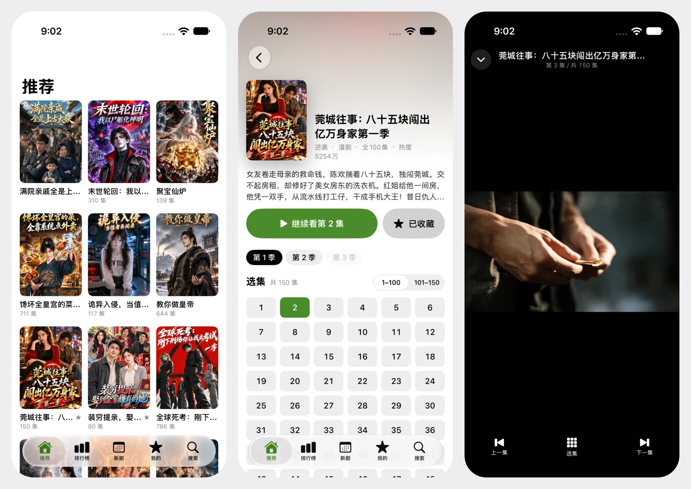
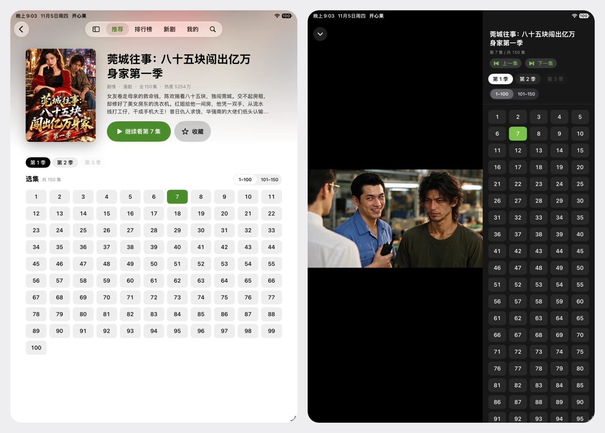

<p align="center">
  
</p>

<h1 align="center">开心果 iOS</h1>

<p align="center">
  <b>无广告、不烧心</b><br>
  红果短剧的极简 iPhone / iPad / Apple TV 客户端
</p>



开心果 iOS 是 [开心果](https://github.com/kadaliao/kaixinguo)（macOS）的 iPhone、iPad 和 Apple TV 版：没有广告、没有弹窗，打开就是剧。界面用 SwiftUI 写成，播放用系统播放器，支持画中画和锁屏控制。

## 功能

- **发现**：推荐、排行榜（按类型和榜单）、新剧上线（前后两周的日历）、热搜榜，下拉刷新
- **搜索**：边输入边联想，同一部剧的各季按顺序排好
- **收藏**：剧集页点「收藏」，或在任意列表里长按海报
- **续播**：记住每部剧看到第几集、第几秒，「我的 › 最近观看」一点就接着看；看完的集在选集里打勾
- **连播**：一集放完自动下一集，一季看完接下一季
- **回到原处**：退出或被系统关掉后再打开，回到上次的标签和页面；正在看的剧停在退出时的那一秒，点一下接着放
- **选集**：长剧每 100 集一段，多季的剧一键切换
- **沉浸式播放**：视频铺满屏幕，播放几秒不碰屏幕，进度条和按钮就都隐去；点一下画面显示出来，再点暂停。画面中间上滑下一集、下滑上一集，左边上下滑调亮度，右边上下滑调音量（最大到 150%）；顶部切倍速、搜别的剧，「⋯」里调清晰度、定时关闭
- **预加载**：一集正常播放十来秒后，先把下一集开头的一段下载、解密好，切到下一集几乎不用等
- **投屏**：顶部的投屏按钮选 Apple TV 或支持 AirPlay 的电视，视频在电视上放，手机当遥控器
- **长按倍速**：按住画面 2 倍速播放，松手恢复；按住时下滑锁定 2 倍速，之后再按住上滑取消
- **弹幕**：其他观众的弹幕从视频上方飘过，只看不发；不想看就在「⋯」里关掉
- **画中画**：播放时回到主屏幕，视频缩到小窗里继续放；在小窗里点还原，回到播放页
- **锁屏和控制中心**：显示剧名、集数和封面，可以暂停、拖动、换集
- **iPad**：侧栏或顶部标签栏随意切换，播放页右边是选集面板，支持外接键盘
- **Apple TV**：用遥控器浏览推荐、排行榜、新剧、我的和搜索；播放用系统播放器，有弹幕，控制栏里调倍速、清晰度、定时关闭，往下滑是选集
- **签名服务**：内置签名被红果拒绝时，播放可以改用自己部署的签名服务，不用等新版
- 跟随系统的浅色和深色外观



## 安装

开心果 iOS 不在 App Store 上架，需要用 Xcode 装到自己的设备上：

1. 需要一台 Mac，装好 Xcode 26 或更新的版本，以及 [XcodeGen](https://github.com/yonaskolb/XcodeGen)（`brew install xcodegen`）。
2. 克隆仓库，生成并打开工程：

   ```sh
   git clone https://github.com/kadaliao/kaixinguo-ios.git
   cd kaixinguo-ios
   xcodegen
   open Kaixinguo.xcodeproj
   ```

3. 在 Kaixinguo target 的 Signing & Capabilities 里选择自己的开发团队（工程里默认是维护者的团队），连上 iPhone 或 iPad，点运行。
4. 装到 Apple TV 上：先在 Xcode 的 Window › Devices and Simulators 里配对 Apple TV，再在 KaixinguoTV target 里同样选好开发团队，选 KaixinguoTV scheme 运行。

需要 iOS / iPadOS / tvOS 18 或更高版本。第一次打开工程时，Xcode 会从 GitHub 下载 openhongguo 的 Swift 包（约 17 MB）。用免费的 Apple ID 签名的应用 7 天后需要重新安装。

## 使用

| 操作 | 作用 |
| --- | --- |
| 长按海报 | 收藏 / 取消收藏 |
| 长按「最近观看」里的剧 | 继续播放，或从最近观看中移除 |
| 点简介 | 展开 / 收起 |
| 播放时在画面中间上滑 / 下滑 | 下一集 / 上一集 |
| 在画面左边上下滑 | 调屏幕亮度，离开播放页后恢复原来的亮度 |
| 在画面右边上下滑 | 调音量；调到系统最大后还能再往上推到 150% |
| 点播放画面 | 进度条和按钮隐去时，显示出来；显示着时，暂停 / 继续 |
| 播放页顶部的投屏按钮 | 投到 Apple TV 或支持 AirPlay 的电视；再点选「iPhone」收回 |
| 拖视频底部的进度条 | 跳到那里 |
| 播放页底部「选集」 | iPhone 上弹出选集面板 |
| 播放页顶部的搜索 | 搜别的剧，点结果直接播放；点搜索框左边的 ‹ 回来接着放 |
| 播放页的「⋯」 | 倍速、清晰度、定时关闭、弹幕开关、收藏、剧集详情 |
| 按住播放画面 | 2 倍速播放，松手恢复原来的倍速 |
| 按住画面再下滑 | 锁定 2 倍速 |
| 锁定后按住画面再上滑 | 取消 2 倍速，恢复原来的倍速 |
| 横过来 | iPhone 横屏时只显示视频 |
| 横屏的剧，点播放页顶部倍速旁边的旋转按钮 | iPhone 上不转手机也能横屏看，再点回到竖屏；锁了竖屏方向也管用 |

Apple TV 上：

| 遥控器 | 作用 |
| --- | --- |
| 在海报上按住确认键 | 收藏 / 取消收藏 |
| 在「最近观看」里的剧上按住确认键 | 继续播放，或从最近观看中移除 |
| 播放时按一下确认键 | 显示控制栏，右边是倍速、清晰度、定时关闭和弹幕开关 |
| 控制栏显示时往下滑 | 简介和选集，选集里有上一集、下一集、收藏和选季 |
| 返回键 | 收起控制栏，再按一次退出播放 |

iPad 接上键盘时：

| 快捷键 | 作用 |
| --- | --- |
| ⌘F | 搜索 |
| ⌘[ | 返回 |
| ↑ ↓ | 上一集 / 下一集（播放时） |
| Esc | 退出播放 |
| 空格、← → | 暂停 / 继续、快退 / 快进 10 秒（播放时） |

开心果也认 `kaixinguo://` 链接，可以在「快捷指令」或别的应用里用：

| 链接 | 打开 |
| --- | --- |
| `kaixinguo://series/<剧集 ID>` | 剧集详情 |
| `kaixinguo://play/<剧集 ID>?episode=3` | 播放第 3 集；不带 `episode` 时从上次看到的地方接着放 |
| `kaixinguo://search?q=<关键词>` | 搜索 |
| `kaixinguo://discover`、`rank`、`new`、`mine` | 对应的标签页 |

观看记录和收藏只存在设备上，不会上传，删除应用时一并删除。文件格式和 macOS 版相同：

| 内容 | 位置（应用沙盒内） |
| --- | --- |
| 观看记录 | `Library/Application Support/history.json` |
| 收藏 | `Library/Application Support/favorites.json` |
| 匿名设备 | `Library/Application Support/openhongguo/anonymous.json`，不参与 iCloud 备份；用签名服务时另有一个 `anonymous-signer.json` |
| 封面和推荐缓存 | `Library/Caches/` |

Apple TV 上应用不能在 `Library/Application Support` 里存文件，观看记录、收藏和上次的位置存在 UserDefaults 里，匿名设备在 `Library/Caches/openhongguo/anonymous.json`。

## 常见问题

**第一次打开，列表很久才出来？**
第一次启动要注册一个匿名设备，网络慢时可能要等十几秒。之后启动会先显示上次的推荐。

**某些剧提示「暂不支持这种视频格式」？**
目前只支持整段的 MP4，分段（DASH/HLS）的长视频还不能播放。

**有的集数带一把锁？**
那一集需要登录红果账号才能看，开心果不提供登录。

**能投屏到 Apple TV 吗？**
能。播放页顶部点投屏按钮，选 Apple TV 或支持 AirPlay 的电视。视频仍然由手机边下边解密，投屏时手机在 Wi-Fi 上开一个只有电视知道地址的小服务，电视从它那里取解密后的视频，所以手机和电视要在同一个 Wi-Fi 下，投屏时开心果不能被关掉。第一次投屏时系统会问能不能访问本地网络，要选「允许」。只支持 AirPlay，不支持 DLNA（乐播之类）。也可以直接装 Apple TV 版（见「安装」）。

**所有剧都播不了，提示「这一集暂时无法匿名播放」？**
开心果用 openhongguo 内置的签名取播放地址，红果收紧签名校验后可能要等开心果发新版才能恢复。等待期间可以自己部署一个签名服务（步骤见[部署签名服务](https://github.com/kadaliao/kaixinguo/blob/main/docs/signer.md)），在「我的」右上角的齿轮（Apple TV 上在「我的」最下面的「设置」）里填上它的地址和 token。之后内置签名取不到播放地址时，开心果会改用签名服务；只有播放请求会经过它，其他请求不受影响。地址最好用 https：保存时开心果会先检查一下服务，iOS 只允许用 http 连局域网里的地址，别的 http 地址检查不过，可以再点一次「仍然保存」。token 存在钥匙串里。

**加载失败或者播放卡住？**
在 Xcode 里编辑 Kaixinguo scheme，在 Run › Arguments › Environment Variables 里加上 `KX_DEBUG=1`，再从 Xcode 运行，控制台会打印每个请求，提 issue 时附上。

## 开发

```sh
xcodegen                          # 改了 project.yml、增删了文件之后重新生成工程
(cd KaixinguoKit && swift test)   # 逻辑测试：在 Mac 上直接跑，不需要模拟器和网络
xcodebuild test -project Kaixinguo.xcodeproj -scheme Kaixinguo \
  -destination 'platform=iOS Simulator,name=iPhone Air'   # 界面冒烟测试，需要网络
xcodebuild test -project Kaixinguo.xcodeproj -scheme KaixinguoTV \
  -destination 'platform=tvOS Simulator,name=Apple TV 4K (3rd generation)'   # Apple TV 版用遥控器走一遍，需要网络
```

动手之前先读 [docs/architecture.md](docs/architecture.md) 和 [CONTRIBUTING.md](CONTRIBUTING.md)。发到 TestFlight 的流程见 [docs/releasing.md](docs/releasing.md)。

一句话概括实现：剧集是 CENC（AES-CTR）加密的 HEVC MP4，`KaixinguoKit/Sources/CENC` 按需原地解密任意字节区间，`StreamLoader` 作为 AVFoundation 的资源加载器，边从 CDN 下载边解密交给系统播放器，可以随意拖动进度；数据来自 openhongguo 的 Swift 包。

## 致谢

- [openhongguo](https://github.com/beilunyang/openhongguo)：红果短剧的 SDK，开心果的全部数据都来自它
- [开心果](https://github.com/kadaliao/kaixinguo)：macOS 版，本项目的界面和解密逻辑都照着它移植
- [XcodeGen](https://github.com/yonaskolb/XcodeGen)：从 `project.yml` 生成 Xcode 工程

## 许可证

[MIT](LICENSE)

## 免责声明

本项目仅供学习和研究，与红果短剧及其运营方无关。请遵守 openhongguo 的[免责声明](https://github.com/beilunyang/openhongguo#免责声明)，内容版权归原权利人所有。
