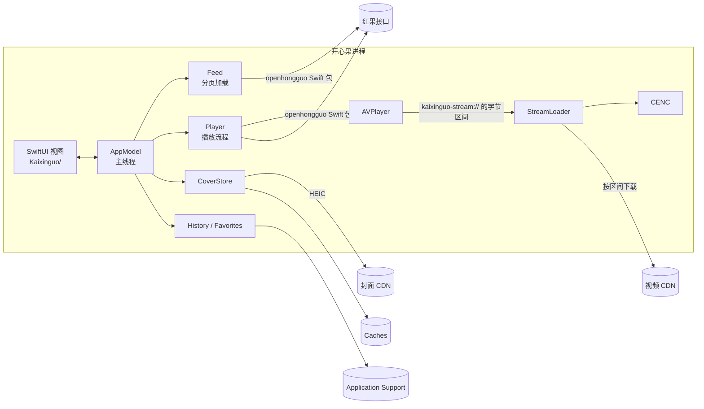

# 架构

这份文档讲开心果 iOS 的代码是怎么组织的、各部分怎么配合，以及几处不太显然的设计为什么这样做。它是 [macOS 版](https://github.com/kadaliao/kaixinguo)的移植，两边的概念一一对应，读过 macOS 版的 `docs/architecture.md` 会更快上手。

## 总览



工程分两部分：

- **`KaixinguoKit/`**：一个 Swift 包，装着除视图以外的一切。它同时能在 macOS 上编译，所以 `swift test` 直接在 Mac 上跑，不需要模拟器。
- **`Kaixinguo/`**：App target，只有 SwiftUI 视图、路由和入口。

`Kaixinguo.xcodeproj` 由 [XcodeGen](https://github.com/yonaskolb/XcodeGen) 从 `project.yml` 生成，增删文件或改设置后运行 `xcodegen`。

## 代码地图

| 文件 | 负责什么 | 对应 macOS 版 |
| --- | --- | --- |
| `KaixinguoKit/Sources/CENC/CENC.swift` | 把 CENC 加密的 MP4 按字节区间还原成明文 | `internal/cenc` |
| `KaixinguoKit/…/StreamLoader.swift` | AVFoundation 的资源加载器：按区间下载、解密、交给播放器 | `proxy.go` |
| `KaixinguoKit/…/Player.swift` | 播放流程：解析播放地址、预取下一集、选流、连播、记录进度 | `play.go` |
| `KaixinguoKit/…/AppModel.swift` | 全部状态、各页的 fetcher、热搜、首页缓存 | `main.go`、`data.go` |
| `KaixinguoKit/…/Feed.swift` | 分页加载的列表，去重、自动重试、下拉刷新 | `data.go` 的 `feed` |
| `KaixinguoKit/…/SeriesPage.swift` | 剧集详情：分集、选季、分段、续播位置、连播的下一集 | `data.go`、`play.go` |
| `KaixinguoKit/…/Seasons.swift` | 季的编号和排序 | `data.go` |
| `KaixinguoKit/…/Card.swift` | 卡片和各种文案（集数、热度、日期） | `data.go`、`view_series.go` |
| `KaixinguoKit/…/Store.swift` | JSON 文件存储、观看记录、收藏 | `store.go`、`history.go`、`favorites.go` |
| `KaixinguoKit/…/Session.swift` | 上次停在哪儿：标签、页面、搜索、播放器开着的那一集 | 无 |
| `KaixinguoKit/…/CoverStore.swift` | 封面：下载、缩小、磁盘缓存、内存缓存 | `covers.go`、`internal/imageio` |
| `KaixinguoKit/…/Catalog.swift` | 对 SDK 的抽象（测试里换成假的）、错误文案 | `data.go` 的 `friendly` |
| `Kaixinguo/KaixinguoApp.swift` | 入口、音频会话、退到后台时写盘、回到上次的地方、`kaixinguo://` 链接 | `main.go` |
| `Kaixinguo/RootView.swift`、`Router.swift` | 标签页（iPhone 底栏、iPad 侧栏）、每个标签的导航栈，以及它们和 `Session` 的互转 | `view.go` 的侧栏和路由 |
| `Kaixinguo/Views/Grid.swift` | 海报网格、卡片、封面、空状态、选择用的胶囊 | `view.go` |
| `Kaixinguo/Views/CatalogViews.swift` | 推荐、排行榜、新剧上线、搜索、热搜、我的 | `view.go` |
| `Kaixinguo/Views/SeriesView.swift` | 剧集详情 | `view_series.go` |
| `Kaixinguo/Views/PlayerScreen.swift` | 播放页（顶栏、进度条、手势、播放页里的搜索）、选集面板、画中画 | `view_player.go` |

## 线程模型

**`AppModel`、`Feed`、`SeriesPage`、`Player`、`History`、`Favorites` 都属于主线程**（`@MainActor @Observable`）。工程用 Swift 6 语言模式，编译器会检查这条约定。

- 视图直接读这些对象的属性，SwiftUI 的 Observation 据此决定重绘哪些视图。
- 网络请求用 `Task { … }` 发起：`await` SDK 时让出主线程，结果回来后在主线程上改状态。
- 视图的 `body` 会反复执行。`model.seriesPage(id)`、`model.rankFeed` 这类在 `body` 里调用的方法要能重复调用：它们缓存在标记了 `@ObservationIgnored` 的字典里，加载前先检查 `loading` 等标记，只发一次请求。
- 不属于主线程的部件各有自己的同步方式：`StreamLoader` 的状态只在它自己的串行队列上读写；`JSONStore` 和 `CoverStore` 用 `Mutex`；解密用的 `Layout` 是不可变的值类型。

## 列表：`Feed`

和 macOS 版一样，推荐、排行榜、新剧上线和搜索都是一个 `Feed` 配一个 fetcher：

- 网格滚到距末尾 9 张卡片时调用 `loadMore`。卡片按 ID 去重；一页里没有新卡片就视为到底，否则搜索会无限请求。
- 列表还是空的时候失败，会在 2、4、8、16 秒后自动重试，之后显示「重试」按钮。
- 推荐页的第一页缓存在 `Caches/home.json`。启动时先显示缓存（`stale`），新数据到了排在前面、缓存排在后面，网格只增不减。下拉刷新用的也是这个办法。
- 排行榜、新剧上线和搜索的 `Feed` 按「榜单 / 日期 / 关键词」缓存，切回来时不用重新加载。

## 播放

剧集是 CENC（AES-CTR，ISO/IEC 23001-7）加密的 HEVC MP4。AVPlayer 不能直接播，开心果给它一个自定义协议的地址，自己当资源加载器：

1. **解析**（`Player.resolve`）：通过 SDK 取这一集的播放模型和内容密钥。正在播的时候会预取下一集；CDN 地址一分钟内过期的模型会重新取。
2. **选流**（`pickStream`）：默认选分辨率最高、码率最高的一路；看的人在「更多 › 清晰度」里选过的话，选不高于它的最高一路。分段的 HLS/DASH 和音视频分离的流目前不支持，直接提示。
3. **登记**：为这一集建一个 `StreamLoader`（主地址、备用地址和密钥），换回一个 `kaixinguo-stream://episode/<随机 ID>.mp4` 的 `AVURLAsset`。`Player` 只保留最近 3 个加载器。
4. **播放**：AVPlayer 向加载器要内容信息和一个个字节区间。加载器第一次被问到时读文件头 64 KB，用 `Layout.open` 找到 `moov`，算出每个样本的位置和 IV；之后每个区间都从 CDN 取同一区间，边收边原地解密，再交给播放器。下载断开时从断点接着取，换另一个 CDN 地址，最多两次。
5. **回报**：`Player` 用 KVO 和通知观察播放器：开始播放、缓冲、出错、播完，每 3 秒和暂停时记录进度，播完自动连播下一集或下一季。

`CENC` 是 macOS 版 `internal/cenc` 的逐行移植，关键同样是**解密不改变任何字节的位置**：样本原地解密，标记加密的盒子改名成同样长度的明文盒子（`encv` → `hvc1`、`sinf` → `free` 等）。所以明文文件的任意区间就是密文文件同一区间解密后的结果，播放器可以随意拖动。它的输出和 Go 版逐字节一致，见 `CENCTests` 里的 `decryptsRealEpisode`。

和 macOS 版用本机 HTTP 代理 + WebView 相比，资源加载器不开端口，播放器是系统的 `AVPlayerViewController`，画中画和锁屏控制都是现成的；它自带的控件藏了起来，播放页用自己的顶栏、进度条和手势（点按暂停、上下滑换集、长按倍速，都挂在它的视图上）。代价是 AirPlay 投屏拿不到解密后的视频，所以 `allowsExternalPlayback` 是关着的。

### 画中画

`PlayerHost` 全程只用一个 `AVPlayerViewController`。画中画开始时关掉播放页（视频留在小窗里），控制器还被 `PlayerHost` 持有，所以画中画不会断；在小窗里点还原时重新打开播放页，把同一个控制器放回去，视频飞回原处。

## 回到上次的地方

App 退出或被系统关掉后再打开，回到上次的样子。`Session` 记着：

- 所在的标签，每个标签里打开的剧集页（只记剧集 ID，页面打开时重新加载），搜索框里的字和正在显示的搜索；
- 排行榜选的类型和榜单、新剧上线选的日子；
- 播放器开着的话（全屏或画中画），是哪部剧的第几集。

几处做法：

- **随改随存**：`KaixinguoApp.keep` 用 `withObservationTracking` 盯着 `Router` 和 `AppModel` 里这些属性，一变就存到 `session.json`（和上次一样就不写）。不等退到后台再存，因为从多任务界面划掉 App 时不一定有机会；画中画在后台连播下一集时也能记下来。
- **播放位置从观看记录里取**：`Session` 只记第几集，秒数用 `history.json` 里这一集的位置。播放器暂停时会记一次进度，App 离开前台（`scenePhase` 不是 `.active`）时也补记一次，所以能精确到秒。
- **暂停着回来**：`Player.play(…, paused: true)` 加载这一集、跳到那一秒（`seek` 的容差是零，不会落到几秒外的关键帧），但不播放，画面上显示暂停图标，点一下接着放。看完的那一集从头开始。
- **直接出现**：启动时播放页不做上滑动画，避免先闪一下下面的页面（`RootView` 第一帧之前关掉过渡动画）。
- **过期的选择不恢复**：新剧上线的日历只有今天前后各一周，选的日子已经不在里面的话回到今天。
- 用 `kaixinguo://` 链接打开 App 时，先恢复再打开链接；链接要去某个页面的话，会先关掉恢复出来的播放页。

## 封面

封面 CDN 只给 HEIC，ImageIO 直接能解。`CoverStore` 解码时缩小到最长边 600 像素（3 倍屏上网格里的海报），以 JPEG 存到 `Caches/covers/`，内存里用 `NSCache` 保留解码后的位图，内存紧张时系统会自动清掉。

- 缓存的键是去掉查询参数的 URL 的 SHA-1，因为签名参数每次都变。
- 同一张封面同时被多处请求时只下载一次。
- 视图先同步查内存缓存，有就直接显示，没有才异步加载并淡入，滚动时不闪。

## 本地数据

| 文件 | 内容 | 写入方 |
| --- | --- | --- |
| `Application Support/history.json` | 观看记录，最近的在前，最多 200 部；每部记着看到哪里和看完了哪几集 | `History` |
| `Application Support/favorites.json` | 收藏，最近收藏的在前 | `Favorites` |
| `Application Support/session.json` | 上次停在哪儿，见「回到上次的地方」；只有 iOS 版有 | `AppModel.save` |
| `Application Support/openhongguo/anonymous.json` | SDK 注册的匿名设备，不参与备份 | openhongguo |
| `Caches/home.json` | 推荐页第一页 | `AppModel` |
| `Caches/covers/` | 封面 JPEG | `CoverStore` |

`history.json` 和 `favorites.json` 的格式与 macOS 版相同（字段名一样，时间是 RFC 3339），两边的文件可以互相读。`JSONStore` 的规则也一样：

- 主线程改完列表调用 `save`，后台队列写盘；还没来得及写的旧快照直接丢弃，只写最新的。
- 原子写入，中途崩溃也不会留下半个文件。
- 文件不存在或读不出来时当作空列表。
- 退到后台时（`scenePhase == .background`）调用 `flush`，等最后一次写入落盘。

字段一旦发布就要保持兼容：只能加字段，不能改名或删除，新字段解码时要有默认值。

`history.json` 里的 `watched` 是 iOS 版加的字段：这一季看完的集号，从小到大。一集播完，或播过九成（常有人跳过最后几秒直接看下一集），就记进去；`History.record` 把新记录和旧记录的 `watched` 合并，所以每 3 秒一次的进度记录不会把它冲掉。macOS 版还不认这个字段，读到会忽略。

## 测试

```sh
(cd KaixinguoKit && swift test)
```

- **逻辑测试**（`KaixinguoKitTests`）用 `FakeCatalog` 代替 SDK，不联网：分页和去重、缓存合并、自动重试、搜索回退和补封面、选季和续播、播放状态、观看记录和收藏的读写（包括 Go 写的文件）。
- **解密测试**（`CENCTests`）在测试里从零拼出加密的 MP4（用 CommonCrypto 自己的 CTR 模式加密，不拿解密器验证自己），覆盖 senc、子样本、saiz/saio、moov 在文件末尾等情况，整段和任意切片解密结果必须一致。

两个可选的测试需要真实数据：

```sh
# 拿一集真实的加密剧集：和 Go 版的输出逐字节比较，并经 StreamLoader 交给 AVFoundation 解码、播放、拖动
CENC_SAMPLE=enc.mp4 CENC_KEY=<密钥> CENC_CLEAR=clear.mp4 swift test --filter "decryptsRealEpisode|playsEncryptedEpisode"

# 联网：从注册匿名设备到播放推荐的第一部剧，再下载一张封面
KX_ONLINE=1 swift test --filter playsOnline
```

**界面冒烟测试**（`KaixinguoUITests`）在模拟器里像用户一样操作：打开推荐的第一部剧、收藏、在「我的」里找到它、播放、下一集、退出后看到「继续看第 2 集」；播放几秒暂停、关掉 App 再打开，回到同一集的同一秒，退出播放页后是那部剧的详情页。它用真实接口，需要网络。Debug 构建启动时认 `-KXFresh YES`，像第一次打开那样不恢复上次的地方，测试用它保证每次从推荐页开始。

**截图**：Debug 构建启动时认 `-KXOpen <链接>` 参数，直接打开 `kaixinguo://` 链接，不弹系统的确认框；这时也不恢复上次的地方。`scripts/shoot.sh` 用它构建、启动并截图：

```sh
scripts/shoot.sh "iPhone Air" kaixinguo://series/<剧集 ID> /tmp/series.png
```

## 已知限制

- 不支持分段（DASH/HLS）和音视频分离的流。
- 需要登录才能看的集数不能播放，应用不提供登录。
- AirPlay 只能屏幕镜像，不能把视频投给 Apple TV 单独播放。
